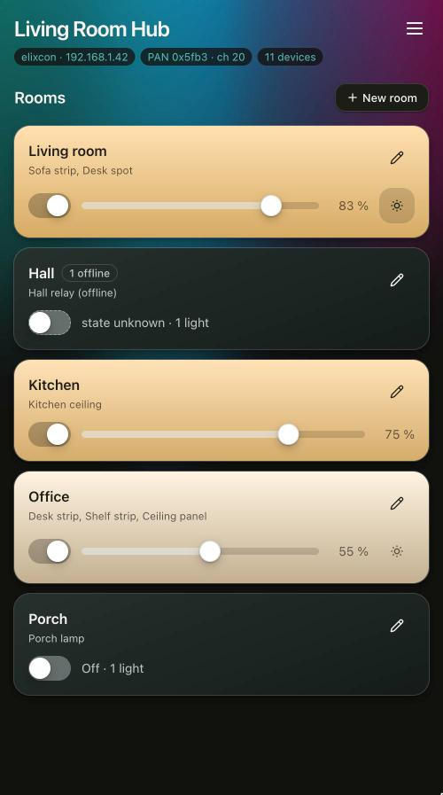
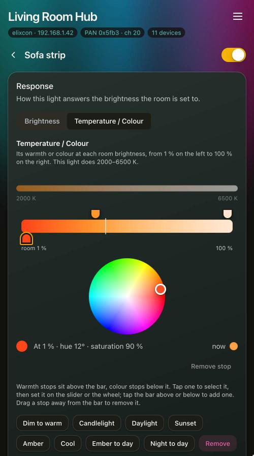
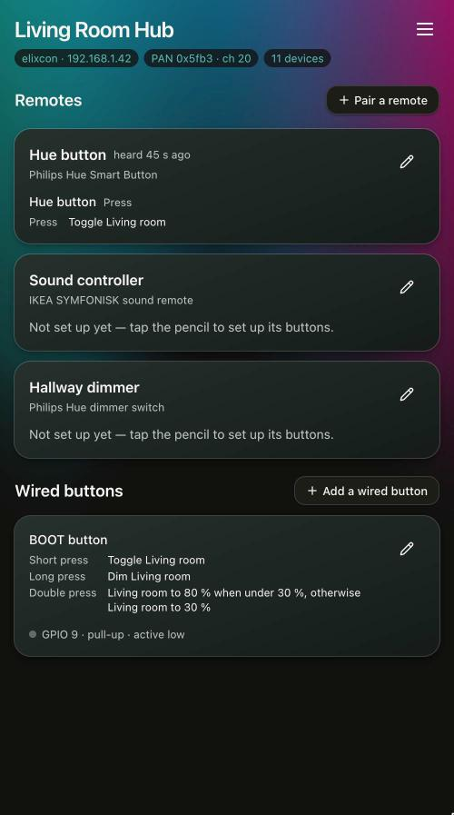

# Elixcon Light Hub

Elixcon Light Hub is firmware for an ESP32-C6 board that makes the lights of a room act as one:
Zigbee lamps, and LED strips or relays wired to the board, become a single dimmable light in Apple
Home, Home Assistant or Alexa, over Matter. The board runs its own Zigbee network, joins your Wi-Fi
with the same chip, and serves the web page you set it up with. Everything runs on the board.

<p align="center">
  
  
  
</p>

In these documents the board running the firmware is called the coordinator, the Zigbee name for the
device that runs a network.

> Disclaimer: The code in this project is mostly AI-generated and, to be honest, I didn’t review it.
> However, steering and testing were done by a human on real hardware over several months. This
> project would not have been possible without AI.
> 
> The amount of Zigbee hardware I had available was limited, so please feel free to send a PR for
> additional devices or features. I’m not sure if we can fit every desired feature into 4 MB
> flash, but I'm eager to see what's possible.

## The idea

- **One light per room.** Controllers see a room as one dimmable light; the board works out what
  each lamp does.
- **Scenes on one slider.** Each lamp has a curve for its brightness and its colour temperature or
  colour across the room's brightness, so dimming the room walks through scenes you design: a warm
  floor lamp at 10 %, everything bright and cool at 100 %. Unlike Zigbee scenes, there is nothing to
  teach each controller.
- **Independent.** Wired switches and Zigbee remotes are handled on the board, so they keep working
  when Home Assistant, a controller, the internet or the router is down. The exception: a board
  that starts without Wi-Fi turns Zigbee off after about two minutes, until the network is back.

## What it does

- Pairs Zigbee lamps, plugs and remotes, and finds out what each lamp can do: switch, dim, change
  colour temperature, show colours.
- Puts lamps into rooms, each with one switch and one brightness slider.
- Gives every lamp a response curve, so one room slider can dim each lamp along its own path, warm
  it as it dims, or switch it out of the room below a set brightness.
- Fades lights on, off and between levels, and can leave each lamp at its warmest white when it goes
  off, so it comes back on warm in the evening.
- Adaptive Lighting: a room can follow the sun, dimmer and warmer towards midnight and brighter and
  cooler towards noon.
- Buttons: push buttons and wall switches wired to the board, and Zigbee remotes (from IKEA, Philips
  Hue and Aqara).
- Wired lights: a relay, or a dimmable or tunable-white LED strip, on the board's pins, used like any
  other lamp, with overheat protection from a temperature sensor.
- Matter bridge: every room shows up as a dimmable light in Apple Home, Home Assistant or Alexa.
- Matter lamps: lamps you already have on your Wi-Fi can be added and used like Zigbee lamps (unfortunately
  we can't do Zigbee and Thread simultaneously on one ESP32-C6).
- Updates its own firmware over the network, and the firmware of Zigbee devices from the Zigbee2MQTT
  OTA collection, one device at a time.
- Optional access control with keys, and a button sequence to get back in when the keys are lost.

Zigbee scenes and effects are not supported; the response curves take the place of scenes.

## What you need

- An ESP32-C6 board with at least 4 MB of flash. A Shelly Gen4 or another ESP32-C6 device running
  ESPHome can be converted ([converting one](docs/converting.md)), but **Shelly conversions have
  not been tested successfully yet**: be ready to flash the unit over its UART if one fails.
- A 2.4 GHz Wi-Fi network.
- Zigbee lamps, and remotes if you want them. Matter lamps and lights wired to the board work as
  well.

## Installing

### From a release

Each tagged release on GitHub has the images attached, with the version in their names. For a new
board, download `elixcon_light_hub-<version>-factory.bin` and write it with
[esptool](https://github.com/espressif/esptool):

```sh
esptool.py --chip esp32c6 -p <port> write_flash 0x0 elixcon_light_hub-<version>-factory.bin
```

The factory image is for a blank board only. It covers the storage areas too, so writing it to a
board already in use erases the Zigbee network, the paired devices, the Wi-Fi settings, the keys and
Matter. To reflash a board that is in use, unzip `elixcon_light_hub-<version>-usb.zip` and run
`esptool.py --chip esp32c6 -p <port> write_flash @flash_args` inside it, which keeps everything
stored. A board that already runs the coordinator can also update itself over the network ([Firmware
updates](docs/updates.md)).

### From source

```sh
# once: the toolchain
git clone -b v5.5.5 --recursive https://github.com/espressif/esp-idf.git ~/esp/esp-idf
~/esp/esp-idf/install.sh esp32c6

# in every new shell
. ~/esp/esp-idf/export.sh

idf.py -p /dev/cu.usbmodem* flash monitor
```

The build also needs `zopfli` (`brew install zopfli`, or `apt install zopfli`). One build makes two
images, the coordinator and a small updater that installs new versions, and `idf.py flash` writes
both along with the bootloader and the partition table. To reflash later, use `idf.py flash` again:
`idf.py erase-flash` deletes the network and every paired device. Build options, tests and the
source layout are in [docs/development.md](docs/development.md).

## First run

1. The board starts an open Wi-Fi network named `elixcon-XXXX`.
2. Join it. The setup page opens by itself, or go to http://192.168.4.1. It asks for your Wi-Fi
   network and password. The coordinator tries the network before saving it, so a wrong password or
   a network it cannot find is reported on the page and the hotspot stays up.
3. The coordinator restarts, joins your network and is then at http://zigbee.local. Forming the
   Zigbee network takes a few seconds, and until it is done `/api/status` shows `network_up` as
   false.
4. On the *Lights* page, press *Pair a light*, which opens the network for pairing for as long as
   you choose, and put the lamp into pairing mode. Most bulbs have to be factory reset first, by a
   power-cycle sequence or from the remote that came with them.
5. On the *Rooms* page, make a room with *New room* and choose its lights.
6. Pair remotes on the *Remotes* page. For IKEA, Hue and Aqara remotes, *Set up* creates their
   buttons for a room in one step ([Buttons and remotes](docs/buttons-and-remotes.md)).

The page opens on *Rooms*, where every room has a switch and a brightness slider. *Lights*,
*Remotes* and *Settings* are in the menu.

If you run more than one coordinator, give each a name under *Settings*. The address follows the
name: a coordinator named "Living Room Hub" is at `living-room-hub.local`, and it restarts to take
the new name.

Anyone on your network can use the page until you press *Secure it*, which gives your browser a key.
If every key is lost, pressing the board's BOOT button five times, about once a second, opens it
again for two minutes ([Access](docs/access.md)).

## When lamps misbehave

The ESP32-C6 shares one radio between Wi-Fi and Zigbee, and most problems come from that. A lamp
that responds only sometimes, a poor link at close range, or a light that switches and then switches
back usually means the Zigbee channel overlaps your Wi-Fi channel. The default Zigbee channel, 20,
suits Wi-Fi on channels 1-6 and 12-13 and collides with 7-10. *Settings → Zigbee network* can survey
the band and move the network to a better channel without pairing anything again. [Radio and
Wi-Fi](docs/radio.md) explains the channels and the link counters in `/api/status`.

## Documentation

- [Lights, rooms and curves](docs/lighting.md): fades, *Warm while off*, response curves and
  Adaptive Lighting
- [Buttons and remotes](docs/buttons-and-remotes.md): pairing remotes, gestures and rules
- [Wired lights and overheat protection](docs/wired-lights.md)
- [The WLED interface](docs/wled.md): a room's Hue colour lamps as a WLED strip for Hyperion,
  HyperHDR or LedFx
- [Matter](docs/matter.md): the bridge to Apple Home, Home Assistant and Alexa, and adding Matter
  lamps
- [Access](docs/access.md): keys and the failsafe
- [Firmware updates](docs/updates.md), and [updating Zigbee devices](docs/zigbee-device-updates.md)
- [Converting a Shelly or ESPHome device](docs/converting.md): not yet tested successfully on a
  Shelly
- [Radio and Wi-Fi](docs/radio.md): channels, Wi-Fi sleep and link counters
- [REST API](docs/api.md)
- [Development](docs/development.md): building, tests and source layout

## License

[GNU General Public License v3.0](LICENSE).
