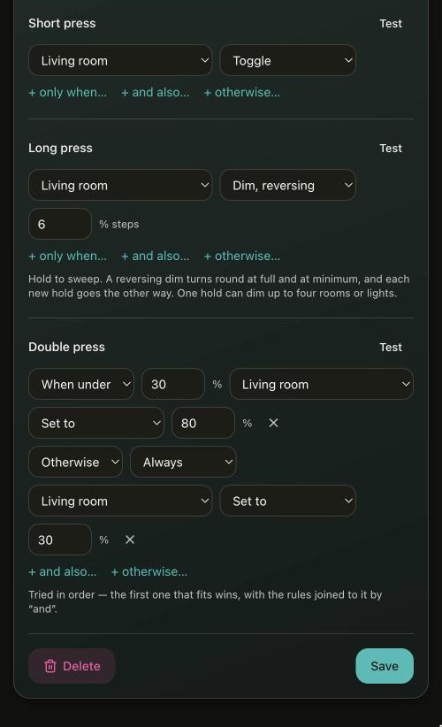

# Buttons and remotes

A button has a source and a set of rules. The source is a pin on the board, with a push button or a
wall switch on it, or one key of a paired Zigbee remote. The rules say what each gesture does to a
room or a light. A [motion sensor](#motion-sensors) is a button too, with motion and no motion in
place of gestures.

## Pairing a remote

Battery remotes pair from *Remotes → Pair a remote*, and each one then has a card on that page. For
a remote the coordinator knows (IKEA BILRESA and SYMFONISK, Hue dimmer switch and Smart Button,
Aqara mini switch, Tuya ZG-101ZL smart button), *Set up* asks for a room and creates all of its buttons with ready-made actions.
For any other remote, use *Add a button* and press the button on the remote that you mean.


Pair a remote while it is awake. The bindings it needs are set up while it joins, and a sleepy
device that misses them only gets them when a later neighbour scan catches it listening, so press it
once after pairing.

Neither IKEA remote needs Touchlink from the coordinator:

- A SYMFONISK sound controller (E1744) joins after four presses of its button.
- A BILRESA scroll wheel (E2490) has to be taken out of Matter first. Hold its pair button for about
  10 s to factory reset it, press it 4 times (Touchlink mode), then 8 times (join; the LEDs go
  dark).

A remote removed from the coordinator is not told to leave, because it would only hear that after
being paired again. Reset the remote instead.

## Which key is which

A remote does not say how many buttons it has, so the key a button means is found by pressing it.
`GET /api/remotes` lists the last few presses from any remote, newest first, each with a `seq` that
never repeats. The page's *press the button you want* panel shows that list and nothing more.

Keys are numbered the same way on every remote. Key 0 is the on/off press, whichever command carried
it, and keys 1 and 2 are the down and up halves of a dimmer. A Hue dimmer switch's Off button is key
3.

A remote that dims by repeating a ZCL `Step` shows up as one press per step. A Hue Smart Button does
this about every 800 ms while held, reversing at the bottom by itself. A `dim_up` or `dim_down` rule
on the short press is what makes holding it work.

A Zigbee button reports `last_event_ms` where a pin reports `pressed` and `level`. There is no pin
to read, and without it "pointed at the wrong key" and "nobody has pressed it" would look the same.

## IKEA remotes

The two IKEA remotes use the same keys, so one set of buttons works with either:

| key | gesture | E1744 SYMFONISK sends | E2490 BILRESA sends |
| --- | --- | --- | --- |
| 0 | short | `Toggle` on a press | `On`/`Off`, alternating, on a wheel click |
| 0 | double | `Step` up on a double press | IKEA Scenes command on a double click |
| 0 | triple | `Step` down on a triple press | the same, on a triple click |
| 2 | long | `Move` up while turning right, `Stop` after | `MoveToLevel` rising, every ~320 ms |
| 1 | long | `Move` down while turning left | `MoveToLevel` falling |

*Set up* on the *Remotes* page creates exactly that: `toggle` on key 0's short press, 100 % and 20 %
on its double and triple press, and `dim_up` / `dim_down` on the long press of keys 2 and 1.

The page shows the buttons of one remote as one card (`web/src/lib/remotes.ts` holds the table of
known remotes). The API and the firmware still see one button per key, at most
`CONFIG_ZBC_MAX_BUTTONS` (16) in all.

The BILRESA never says when the wheel stops. Its hold ends after one and a half times the gap it has
been leaving between frames (0.35-1.5 s; about 0.5 s while turning). While it turns, the dimming
commands go out at the same pace and aim only that far ahead, so the lights stop soon after the
wheel does. Its channel button sends nothing the coordinator can see, so all three channels drive
the same buttons. It also ignores bindings and always sends to Zigbee groups 21658-21660, which the
coordinator joins at startup for that reason.

## Tuya smart button

The ZG-101ZL (HOBEIAN, also sold as Loginovo and Moes) counts its own gestures. Each one arrives as
Tuya's command `0xFD` on the On/Off cluster, 0 for a click, 1 for a double click and 2 for a hold,
followed about 200 ms later by the command it would send a bound lamp: `Toggle`, `On` or `Off`. The
coordinator drops that second command when it follows the first within 500 ms, so each gesture
fires once. If the first frame is lost, the second still counts as a click.

Its hold is a single frame, sent about a second into the hold. Nothing follows while it is held or
when it is let go, so a dimming rule on its long press moves one step per hold rather than sweeping.
*Set up* puts `toggle` on the click, 100 % on the double click and `dim_down` on the hold. A triple
click switches the button's operating mode, and holding it for about ten seconds resets it and
takes it off the network.

## Double presses

Whether a remote can send a double press depends on the remote. One that counts its own presses (an
Aqara WXKG11LM, both IKEA remotes, the Tuya ZG-101ZL) reports them directly. One that sends two ordinary presses has
them paired up by the coordinator. A Hue Smart Button can do neither: it merges a quick second tap
and sends one command per pair of taps, so the gesture never reaches the network.

A double rule on a remote that does not count its own presses has a cost. Every single press on that
button then waits out the 300 ms window before it fires, because until the window closes nothing can
know whether a second press is coming.

## Wired buttons

A button on a pin says what is wired to it in `input`. A `button` springs back, so it has short,
long and double presses. A `switch` stays where it is put, and every flip, either way, is one short
press. The wall-switch input of a converted Shelly is a switch on GPIO 12 (see [Wired
lights](wired-lights.md#a-converted-shelly)).

Every pin button reports `pressed` (debounced) and `level` (the raw pin). Those two are the only way
to tell a wiring mistake from a configuration mistake.

## Rules

A button has four gestures: `short`, `long`, `double` and `triple`. The triple press only comes from
a remote that counts its own presses. Each gesture has a list of rules, tried in order, and the
first one whose `when` matches is the one that runs. A final `"when":"always"` therefore reads as
"otherwise". A button holds twelve rules across all its gestures.



A rule acts on a room (`group`) or on one light (`ieee` and `ep`, as `/api/devices` names it,
including wired lights and Matter lamps), and its `when` is checked against that same room or light.

A rule with `"and":true` does not compete with the others. It runs whenever the rule above it runs,
so one press can switch several things, and its own `when` is not read. Two or more `toggle` rules
that run together are decided together: if any of their targets is lit they all go off, and
otherwise they all come on.

`when` is one of `always`, `on`, `off`, `below`, `above` or `sun_down`. `below` and `above` compare
with `arg`, a percentage. `sun_down` holds between sunset and sunrise at the location set for
[Adaptive Lighting](lighting.md#adaptive-lighting), and needs no room or light. Without a location,
or before the clock is set, it holds: a room is lit rather than left dark.

`do` is one of `none`, `on`, `off`, `toggle`, `set`, `dim_up`, `dim_down`, `dim_cycle` or
`adaptive`. `adaptive` (start [Adaptive Lighting](lighting.md#adaptive-lighting)) works on rooms
only.

## Delayed actions

A rule's `delay` makes it wait that many seconds (up to 65535) after its event before it runs:
"turn on the kitchen, and turn it off after 10 minutes". The other rules of the case run at once.
The next event of the same button drops whatever it still has waiting, so a second press restarts
the timer, and motion takes back an "off" that no motion scheduled. Saving or deleting the button
drops them too, and so does a restart. A waiting `toggle` decides from its own target when it runs.
A `dim_*` rule cannot wait: it only means something while the button is held.

`/api/buttons` shows what a button has waiting as `delayed`: `count` and `next_ms`, or `null`.

## Motion sensors

A Zigbee sensor with the Occupancy Sensing cluster pairs like a remote and appears on the
*Sensors* page: Xiaomi and Aqara (`lumi.sensor_motion`, `.aq2`), Philips Hue (SML00x), IKEA
VALLHORN and others. IAS Zone sensors (most Sonoff and Tuya ones) are not supported yet. A sensor is
set up by picking a room. That turns the room on with motion and off after two minutes without, and
both can be changed from there.

Its rules have two events, `motion` and `clear`. `motion` runs when the sensor reports motion in a
quiet room; further reports only push the clear back. `clear` runs once nothing has moved for the
sensor's `clear_s` (30 to 3600 seconds). Sensors disagree on how they say so:

- A Xiaomi or Aqara sensor reports motion at most once a minute and never reports that it ended.
  The time is counted from its last report, so anything under about two minutes can end while
  somebody is still moving in the room.
- A Hue or IKEA sensor reports the end of motion itself. The time is counted from that report. If it
  is lost, the sensor's next periodic report (every five minutes) puts it right, and after 30 minutes
  with no report at all the room is taken as clear anyway.

The coordinator learns which kind a sensor is from the first "unoccupied" it hears, and keeps that
(`reports_clear` on the endpoint in `/api/devices`).

After a restart a sensor's `clear` rules run once, `clear_s` after the start, unless something moves
first (which runs its `motion` rules as usual). A room the sensor lit before the restart therefore
still goes dark.

A sensor's rules never dim. Its `clear` rules always run when the time is up, even if somebody
switched the room by hand in the meantime: a condition such as `"when":"on"` is the way to limit
them. `/api/buttons` shows a sensor with `occupied` (null until it has been heard since the start)
and `clear_in_ms`.

## Holding a button

A long press repeats while the button is held, so a `dim_*` action sweeps. `dim_cycle` turns round
at full and at minimum, and each new hold goes the other way.

The `value` on a `dim_*` action is read as that many percent every 250 ms, so 6 takes a little over
four seconds from one end to the other. The commands themselves go out once a second, each covering
the distance the clock says it should. Each command aims one interval ahead of the sweep, with a
matching transition, so the lamps keep moving instead of arriving and waiting.

A hold with several `dim_*` rules moves each target from its own level at its own speed, up to four
at once. The reversing ones turn round together.

Releasing the button sends a ZCL Stop and then commands the position the sweep reached. The lights
end where the finger left them, instead of carrying on to the level the last command was aiming at.

Testing a long press with `POST /api/buttons/{id}/test` holds the pin down for `hold_ms` (2.5 s by
default, 20 s at most), so the sweep and the stop that ends it run for real.

## Setting buttons up from a script

A button's `source` is `"gpio"`, `"zigbee"` or `"sensor"`. A pin button has `gpio`, `pull` and
`inverted`; a Zigbee one has `ieee`, `ep` and `key` instead, and a sensor `ieee`, `ep` and `clear_s`.
`PATCH /api/buttons/{id}` replaces the whole record.

```sh
# a button on the board's own BOOT button: toggle on a click, hold to dim, and
# a double click that lifts a dim room to 80 % but otherwise drops it back to 30
curl -X POST http://zigbee.local/api/buttons -d '{"name":"Kitchen switch"}'
curl -X PATCH http://zigbee.local/api/buttons/1 -d '{
  "gpio": 9, "pull": "up", "inverted": true,
  "events": {
    "short":  [{"group":1,"when":"always","do":"toggle"}],
    "long":   [{"group":1,"when":"always","do":"dim_cycle","value":6}],
    "double": [{"group":1,"when":"below","arg":30,"do":"set","value":80},
               {"group":1,"when":"always","do":"set","value":30}]}}'
curl -X POST http://zigbee.local/api/buttons/1/test -d '{"event":"long"}'

# one press for the room and a lamp beside it: both on if the kitchen is off
# (the lamp at 30 %), otherwise both off; a hold dims the two together
curl -X PATCH http://zigbee.local/api/buttons/1 -d '{
  "events": {
    "short": [{"group":1,"when":"off","do":"on"},
              {"ieee":"0x00124b0001abcdef","ep":1,"and":true,"do":"set","value":30},
              {"group":1,"when":"always","do":"off"},
              {"ieee":"0x00124b0001abcdef","ep":1,"and":true,"do":"off"}],
    "long":  [{"group":1,"when":"always","do":"dim_cycle","value":6},
              {"ieee":"0x00124b0001abcdef","ep":1,"and":true,"do":"dim_cycle","value":6}]}}'

# a motion sensor: the hall on with motion after dark; after three minutes
# without, down to 20 %, and off a minute later unless something moves
curl -X POST http://zigbee.local/api/buttons -d '{"name":"Hall motion"}'
curl -X PATCH http://zigbee.local/api/buttons/2 -d '{
  "source": "sensor", "ieee": "0x00158d00014dc9e0", "ep": 1, "clear_s": 180,
  "events": {
    "motion": [{"group":2,"when":"sun_down","do":"on"}],
    "clear":  [{"group":2,"when":"on","do":"set","value":20},
               {"group":2,"and":true,"do":"off","delay":60}]}}'
```

The button routes are listed in the [REST API reference](api.md#buttons-and-remotes).
