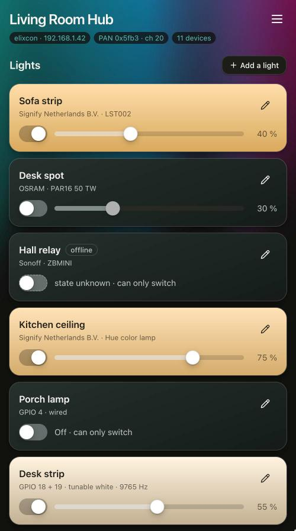
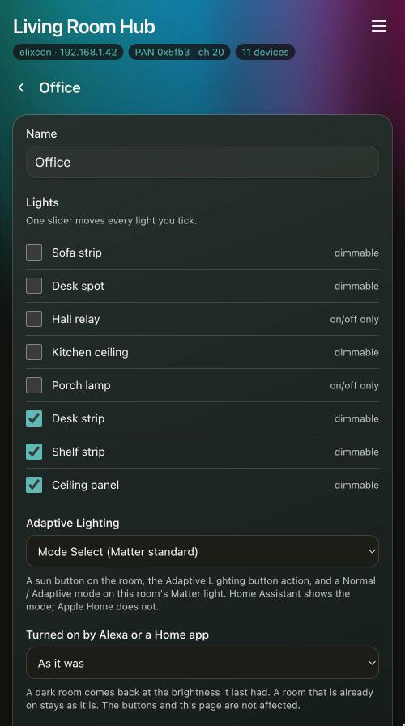
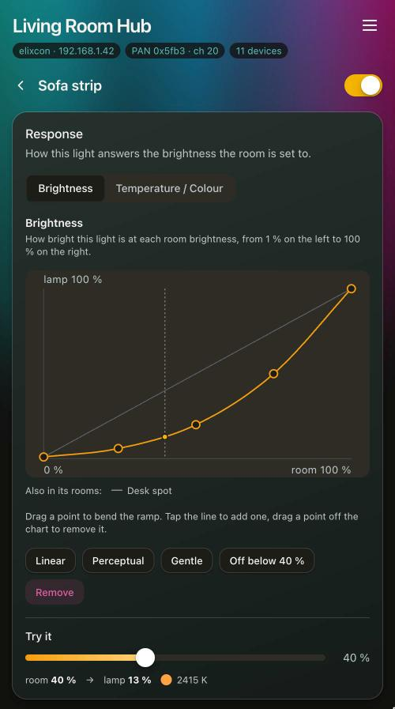
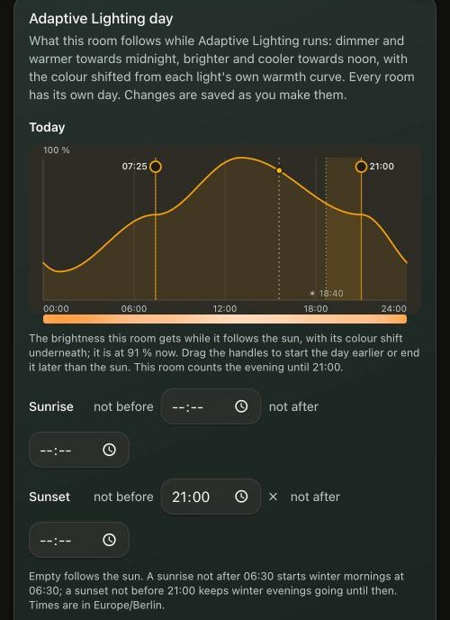

# Lights, rooms and curves

This page covers how the coordinator treats lamps and rooms: fades, *Warm while off*, response
curves and Adaptive Lighting. Buttons and remotes have [their own page](buttons-and-remotes.md), and
so do [wired lights](wired-lights.md) and [Matter lamps](matter.md#matter-lamps).

## Lamps

Every device that joins is interrogated. The coordinator asks for its active endpoints and their
simple descriptors, and reads the manufacturer and model from the Basic cluster. What each endpoint
can do (on/off, brightness, colour temperature, colour) comes from its cluster list and its
ColorCapabilities attribute, never from a list of known models. Lamps that only take CIE xy get
colours converted for them, so the page has one colour wheel for every lamp.

The coordinator also subscribes to attribute reports, so a lamp switched from somewhere else shows
its new state.



## Rooms

Rooms (called groups in the API) are kept by the coordinator. It holds the list of members and sends
each lamp the ordinary per-lamp command; the ZCL Groups cluster is not used. Nothing is stored on
the lamps, so a lamp that is factory reset and joins again is still in its room. The cost is that
the lamps in a room change a few tens of milliseconds apart instead of in lockstep.

Make a room with *New room* on the *Rooms* page, then open it to choose its lights. A light can be
in more than one room.



## Fade time

A single setting under *Settings* decides how long lights take to move between states. Dimming,
colour temperature and colour are "move to" commands that carry a transition time, so the setting
goes along with them.

Switching on and off is harder, because the On/Off commands carry no transition. Zigbee's answer is
a set of Level Control attributes, `OnOffTransitionTime` and the more specific `OnTransitionTime`
and `OffTransitionTime`, which the coordinator writes whenever a device joins. Lamps may ignore
them, and common ones do. A Philips Hue LST002 refuses all three with `UNSUPPORTED_ATTRIBUTE`. An
OSRAM PAR16 accepts them, reads all three back at the values it was given, and still switches
instantly.

So with a fade set, switching does not rely on those attributes:

- Off is `OffWithEffect`, the one ZCL command that fades a lamp out and switches it off by itself
  (over 0.8 s). There is no ramp to level 0, because a Hue lamp stops at level 1 and stays faintly
  lit.
- On switches the lamp on at the bottom of its range and ramps it up to the level it had, as one
  command. A lamp keeps its old level while it is off, so without that first step it would light at
  the old level and then slide to the new one.

This needs nothing from a lamp beyond the Level Control cluster, which every dimmable light has, and
it makes lamps from different makers behave the same way.

The level a light returns to is remembered while the coordinator runs, but not across a restart.
After one, a light comes back at the level it holds, or at full if it was left at the bottom of its
range.

Set the fade to *Instant* to go back to plain On/Off commands. Lights that cannot dim always get
those.

[Wired lights](wired-lights.md) fade on the board itself: their switch-off takes the fade time
rather than the 0.8 s of `OffWithEffect`, and both directions ease in and out.

## Warm while off

Switching a light on gives it a level and nothing else, so it lights in whatever colour it was left
in. In the evening that is usually the daylight it was set to at noon, and it shows until the next
colour command arrives.

*Warm while off* under *Settings* deals with this as the light goes off. The light is first taken
down to 1 %, then set to its warmest white and switched off in one command. Lamps keep their colour
temperature while they are off, so the next switch-on starts warm, whether it comes from this
coordinator, a remote or a Matter controller.

The dim leaves the lamp at the bottom of its range while it is dark, which is where the next
switch-on fades up from. It also decides whether a Hue lamp takes the colour that follows a
switch-on: from the bottom of its range it does, and from its old brightness it ignores it. The
colour has to be sent while the lamp is still lit, because a Hue LST002 acknowledges Zigbee's
`ExecuteIfOff` option for colour commands and then ignores it.

Each lamp goes to its own warmest, read from its `ColorTempPhysicalMaxMireds` at pairing, so a lamp
that stops at 2700 K and one that reaches 2000 K both go as far as they can. A lamp that is already
at its warmest is left alone. That is the usual case when the evening ends with the lights dimmed
down, since a warmth curve has taken them there already. Lights without colour temperature are not
affected, and a light switched off at the wall never hears any of it.

It costs three commands to the lamp instead of one, and the lamp goes dark a moment later. With the
fade set to *Instant* the light is not dimmed first. The setting is off by default.

## Response curves

A room slider that sets every lamp to the same percentage does not light a room well. So each light
has a response curve, which maps the brightness the room was asked for onto what that lamp does. A
curve has two parts.

The brightness curve gives the output in percent. A ceiling light can run 20-100 % across the top
half of the slider while a floor lamp covers the bottom half. An output of 0 means off: a level
command alone cannot switch a lamp off, so the coordinator sends an off instead, and that is how a
lamp drops out of a room and comes back. A light that can only switch reads its curve as a switch
point, on at or above a brightness and off below it.

The temperature and colour path has up to eight stops. Each stop is a colour temperature in kelvin
(clamped to what the lamp can reach) or a colour as hue and saturation, and one path can mix both:
deep magenta at 1 %, 3300 K at 40 %, daylight at the top.

Between a colour and a colour temperature, the path is blended in CIE xy. A colour temperature is a
point on the Planckian locus, so xy is the one space where a hue and a kelvin value are the same
kind of thing, and the colour fades towards the white without swinging through other hues on the
way. Stretches that are only warmth are still sent as colour temperature, so the lamp's own white
calibration and its mired limits still apply. The command type changes where the path crosses from
one kind to the other, and a lamp whose 3300 K differs from the textbook value may show a small step
there.

Control points are joined by a Fritsch-Carlson monotone cubic. A single polynomial fitted through
the same points oscillates between them, can leave the valid range, and can reverse, which would be
a lamp that dims as the slider goes up. The monotone cubic does none of these, and moving one point
changes the curve only as far as the points on either side.

Lights without a curve pass the percentage straight through, and a light without a path keeps
whatever warmth or colour it has: the room's brightness does not change it.

### Editing a curve

Curves are edited at the top of a light's page.

<p>
  
  
</p>

Brightness is a graph with a few draggable points and a strip that previews the whole dimming range.
When the light is in a room, the other members' curves are drawn faintly behind it, so you can see
how the room fits together.

Temperature and colour share one strip that shows the path across the whole slider, with warmth
stops marked above it and colour stops below. Tap a stop to select it, then set it with the kelvin
slider or the colour wheel. Setting it with the other control turns it into a stop of that kind.
For a light that has no path yet, the strip shows one to start from, dimmed and marked *Not in use*:
it takes effect once you change a stop, pick a preset or press *Use this path*. Tapping a stop only
selects it.

There are presets, changes apply as you make them, and a *Try it* slider drives the lamp and marks
where it is on the curve and the path.

A light's page has no separate colour controls. A lamp's warmth and colour come from its path, so
they follow the brightness instead of being set by hand and then overwritten by the next brightness
change. Scripts can still set a colour directly through the [REST API](api.md).

### Setting curves from a script

`POST /api/devices/{ieee}/ep/{ep}/curves` replaces a light's curves. `level` takes points as `[room
%, output %]`, and `chroma` takes stops with `at` (room %) and either `kelvin` or `hue` and `sat`. A
`null` member clears that part.

```sh
# dim to warm, and drop this lamp out of the room below 40 %
curl -X POST http://zigbee.local/api/devices/0x00124b0001abcdef/ep/1/curves -d '{
  "level":  {"points": [[1,0],[39,0],[40,20],[100,100]]},
  "chroma": {"stops": [{"at":1,"kelvin":2000},{"at":50,"kelvin":2700},
                       {"at":100,"kelvin":4000}]}}'

# magenta at the bottom of the room slider, blending into daylight at the top
curl -X POST http://zigbee.local/api/devices/0x00124b0001abcdef/ep/1/curves -d '{
  "chroma": {"stops": [{"at":1,"hue":307,"sat":78},{"at":40,"kelvin":3300},
                       {"at":100,"kelvin":6000}]}}'
```

Each endpoint in `/api/devices` carries `curves` (which parts it has) and `input_pct` (the
brightness last asked for). A client that shows a slider should bind it to `input_pct` whenever a
level curve is active. `brightness_pct` is what the lamp reports, which is the curve's output and so
a different number.

## Adaptive Lighting

A room can follow the sun: dimmer and warmer towards midnight, brighter and cooler towards noon.
Once a minute the coordinator works out a brightness and a colour temperature offset from the sun's
position at your location, and sends them through the room's ordinary path. Each light's brightness
curve still decides its share, and the offset shifts its warmth curve without replacing it. Lights
set to a colour instead of a warmth are not shifted.

Set the location under *Settings → Adaptive Lighting*. Each room has its own day, set on the room's
page under *Rooms* once the room offers Adaptive Lighting. A room's day is two values each at solar
midnight and solar noon, a brightness and a colour temperature offset. Sunrise and sunset land
halfway between them. A room nobody has set goes from 20 % and 1500 K warmer at midnight to 100 %
and 500 K cooler at noon. The clock comes from SNTP. The room's page draws today's curve, the
brightness over the day with the colour shift underneath it, and marks where the room is now.

A light that belongs to two rooms that both run Adaptive Lighting follows whichever room moved it
last.

### Stretching the day

Following the sun means the evening starts earlier as the days get shorter. With sunset at 16:30
in December, a room is already well on its way down by 20:00. Each end of the day can be held to
clock times:

- **Sunrise not after** 06:30 starts winter mornings at 06:30, as if the sun rose then.
- **Sunset not before** 21:00 keeps winter evenings going until 21:00.
- **Sunrise not before** and **sunset not after** do the opposite for summer, when the sun rises
  at five.

An empty field follows the sun. Drag the sunrise and sunset handles on the chart, or type the times.
The sun's own times stay dotted on the chart, and the stretch between them is shaded. A moved
sunrise or sunset keeps half an hour clear of noon and of solar midnight, and a polar day or night
is not stretched.



The times are local clock times, so the coordinator needs a time zone. The page sends the browser's
own zone with the first limit, and daylight saving time is handled on the coordinator. The zone is
used for these limits only; everything else works in UTC. If the coordinator's zone is not the
browser's, *Settings → Adaptive Lighting* says so and offers to replace it. The zone cannot be
removed while a room has limits.

### Shaping the day

The two values are joined by a straight line by default. Under *Brightness* and *Colour shift*, the
line from midnight (left) to noon (right) can be bent with up to four more points, in the same editor
as a light's brightness curve. Morning and evening share the curve, and both cross the middle at
sunrise and sunset. *Bright until sunset* keeps the room near full all afternoon. *Warm evenings*
makes most of the night's warmth arrive by sunset while the brightness is still high. *Straight* goes
back to the two values alone.

Adaptive Lighting runs from when it is started until something ends it. It starts from a room's sun
button, from a button rule, or from a Matter controller. It ends when the room is switched off or
changed by hand. A restart (an update, a power cut) does not end it: a room that was following the
sun carries on once its lights are back.

Each room chooses, on its own page, how Matter controllers see the mode: not at all, as a Mode
Select (*Normal* / *Adaptive*) on the room's light, or as a second on/off light called "*room*
Adaptive". The second light is for Apple Home, which does not show Mode Select. A change to or from
Mode Select takes effect at the next restart.
