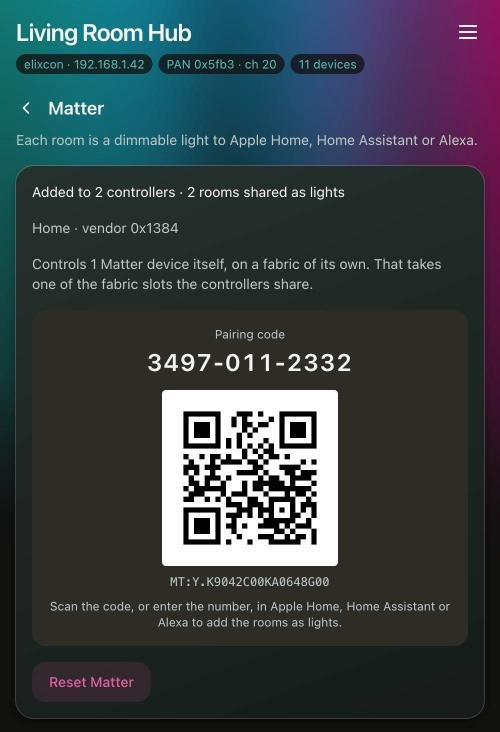

# Matter

The coordinator works with Matter in two directions. As a bridge, it shows your rooms to Apple Home,
Home Assistant or Alexa. As a controller, it adds Matter lamps you already have and uses them like
Zigbee lamps.

## The bridge

The coordinator is a Matter-over-Wi-Fi bridge, and every room is one dimmable light on it, named
after the room. Switching and dimming from a controller go through the same path as the web page, so
response curves and fade times apply, and a change made on the page shows up in the controller
within a second or two.

1. Open *Settings → Matter*. It shows the pairing QR code and the 11-digit pairing code.
2. In the controller, add a Matter accessory and scan the code or type in the digits. Pairing runs
   over your network, not Bluetooth, so the phone has to be on the same Wi-Fi as the coordinator.
3. The controller warns that the accessory is uncertified, because it uses Matter's test
   certificates. Carry on anyway.
4. For a second ecosystem, share the bridge from the first one ("Turn On Pairing Mode" in Apple
   Home, *Share device* in Home Assistant) and use the code it gives you. That is the dependable way
   to add it to Alexa.

The Matter page lists every controller the bridge is in. There is room for five, and Apple Home
takes two: one named after your home, and an unnamed one for Apple's own keychain. Both come from
the same pairing, so two entries after adding the bridge to Apple Home alone is expected. Once a
Matter lamp is paired (below), the coordinator's own fabric takes one more, which leaves four.

The pairing window is open for 15 minutes after a boot while nothing has been added yet. *Allow
pairing* opens it again. Rooms made or deleted later appear and disappear in the controllers by
themselves.

Each room also decides what a controller's "turn on" does: go back to the last brightness, start
[Adaptive Lighting](lighting.md#adaptive-lighting), or go to full. The last two apply to a room that
is already on as well, so "turn on" brings a room dimmed to 10 % to full or into the mode. How the
controllers see Adaptive Lighting is set on the room's page too.

*Reset Matter* forgets every controller and leaves Zigbee lamps, wired lights, rooms and buttons
alone. Matter lamps are asked to forget the coordinator first and then have to be paired again. They
stay in their rooms, curves and buttons, marked *needs pairing again*.

`GET /api/matter` lists the last commands each controller sent, which is where to look when two
controllers behave differently with the same light.

## Matter lamps

The coordinator is also a Matter controller. A Matter lamp you already have in Apple Home, Home
Assistant or another app becomes a light here, like a Zigbee lamp: it goes into rooms, takes
response curves, fades, *Warm while off* and Adaptive Lighting, answers buttons and remotes, and is
shared back out through the bridge. It stays in its own app as well.

Lamps on Wi-Fi, lamps on Thread (reached through your border router, such as a HomePod) and hubs are
all added the same way. A hub such as a Hue Bridge brings every lamp behind it.

1. In Apple Home, open the lamp (or the hub), go to its settings and choose *Turn On Pairing Mode*.
   Other apps call this sharing or linking to another service. It shows a code that works for a few
   minutes.
2. On the *Lights* page choose *Add a Matter lamp* and type in the code. The coordinator finds the
   device on your network, pairs it and reads which of its endpoints are lights. On Wi-Fi this takes
   a few seconds.

Pairing is over the network only. The device's certificate is not checked, and the light's page says
so. A lamp added to a hub later appears after *Rescan device* on any of the hub's lamps.

Removing the last lamp of a device tells the device to forget the coordinator. If the device is
unplugged at the time, also remove the coordinator in the device's own app, or the entry stays in
the lamp's fabric table, which usually has room for five.

A Matter lamp's state comes from a subscription, one per device however many lamps it has, so a
change made in another app shows here at once. A device whose subscription has been down for 30 s
answers commands with `503`, and the coordinator tries it again at least once a minute until it
answers.

Re-pairing a device makes new lights, so its rooms and curves have to be set up again. A rescan adds
lamps that a hub has gained but does not remove ones it has dropped.
