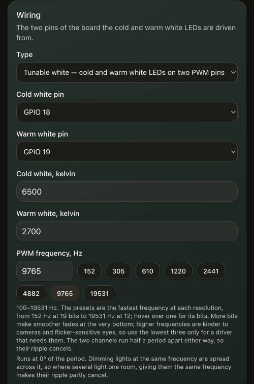

# Wired lights and overheat protection

A relay or an LED strip wired to one of the board's pins can be used like any other lamp. It goes
into rooms, takes a response curve, answers buttons and remotes, and appears through the Matter
bridge with its room.

## Adding one

On the *Lights* page, choose *Add a wired light* and set its wiring:

- the pin it is on, and whether that pin is active low;
- what it does at power-on: off, on, or as it was;
- its kind: a relay (on/off), dimmable, tunable white, or tunable white with three channels.

A dimmable light, such as a single-colour LED strip on a MOSFET, drives one pin with PWM. It has
brightness, and you set its PWM frequency as for tunable white below.

A tunable-white light drives two pins, cold on the first and warm on the second, with PWM. You set
the PWM frequency, the kelvin of the cold and the warm LEDs, and how they are mixed. The light then
has brightness and colour temperature, and its LEDs' kelvin values are its colour temperature
limits. A three-channel one adds a neutral white on a third pin, with its own kelvin between the
other two; Philips Hue's white ambiance ceiling lamps are built this way. The frequency presets are ESPHome's recommended ones, each the fastest at its resolution:
1220 Hz (16 bits), 2441 Hz (15), 4882 Hz (14, the default), 9765 Hz (13) and 19531 Hz (12). Below
those, 610 Hz (17), 305 Hz (18) and 152 Hz (19) are there for drivers that need a low frequency;
cameras see more flicker at these. More bits give smoother fades near the bottom of the range. A
frequency just below a preset gives no more resolution than the preset.

The board has twelve PWM channels on two of the chip's peripherals. A three-channel light takes
three channels, a tunable-white light two and a dimmable light one. The first six (LEDC) take any
light at any of four frequencies, and lights get them in the order they were added, as long as
they fit. The other six (MCPWM) come in three pairs, and both channels of a pair run at one
frequency: a tunable-white light takes a pair, two dimmable lights at the same frequency share one,
and a three-channel light takes a pair and half of another. With every light at one frequency the
board runs, for example, four three-channel lights, six tunable-white lights or twelve dimmable
ones. At most seven frequencies are in use at once. A light that would not fit is refused (`409`)
instead of being accepted and staying dark. A light runs at exactly the same frequency on either,
so lights at one frequency on the two keep in step. MCPWM counts at the same rate as LEDC from
1221 Hz up, and has more steps between LEDC's presets, but its counter is 16 bits: below 1221 Hz a
light on it has 15 to 16 bits where LEDC has 16 to 19. The log says which light runs on which
(`PWM timer 4` and up is MCPWM).

Each tunable-white light spreads the pulses of its lit whites across the period, the dark time
between them shared evenly, so two lit whites are half a period apart. Lights at the same
frequency are also spread across the period (the light's page shows its phase): two dimmable
lights at 0° and 180°, three at 0°, 120° and 240°; two tunable-white lights at 0° and 90°, three at
0°, 60° and 120°; and dimmable lights beside tunable-white ones in the gaps between their pulses.
Where they light the same room, their combined ripple is smaller and at a higher frequency than one
light's. Lights at different frequencies get nothing from this, so give the lights in one room the
same frequency. One cost: when a fade takes a light that is not at 0° past the point where one of
its pulses wraps around the end of the period, that one period is wrong. That lasts 0.2 ms at
4882 Hz and 6.6 ms at 152 Hz.

On MCPWM a light's pulses are centred at its phase rather than starting there, and a tunable-white
light's two pulses are always half a period apart. Lights at one frequency are spread as on LEDC:
tunable-white lights at 0°, 90° or 0°, 60°, 120°, and two dimmable lights sharing a pair at 0° and
180°. A three-channel light's third white is centred where its first is, so in a custom mix that
lights all three, those two overlap. MCPWM lights have no wrapping cost. Lights on LEDC and on
MCPWM are not spread against each other, even at the same frequency.

Switching a wired light on or off fades it over the fade time set under *Settings*, easing in and
out the way ESPHome's light transitions do, and starting from (or ending at) black one PWM step at a
time. Dimming between two brightnesses runs at an even pace, so that a held button or a slider moves
smoothly. A light with response curves fades the way ESPHome's lights do: switching it on or off
glides the brightness it is asked for between dark and its target, and the light shows what its
brightness curve and warmth curve give at each point on the way. A tunable-white light comes on warm
and dim and goes out that way, whatever colour it was left at, and lights in one room fade as one: a
light whose curve keeps it dark below 40 % joins the fade only once the room passes 40 %, and leaves
it before. With *Warm while off* turned on, a light also ends its fade-out at its warmest white. `GET /api/status` → `wired` counts
how regularly the fades were updated (`fade_late`, `fade_max_gap_ms`).

An update that changes how wired lights are stored forgets them, and they have to be defined again
(the log says so at boot). Rooms, response curves and button rules name a wired light by its
number, and numbers are given out from 1 in the order lights are added: defined again in their old
order, the lights take their old places; in another order, check their rooms and rules.

A pin belongs to a light or a button, never to both, and the failsafe pin (`CONFIG_ZBC_UNLOCK_GPIO`,
the BOOT button) is never a light.

From a script, `POST /api/lights` with `{"name":"Porch"}` creates a wired light and answers its
`id`, `ieee` and `ep`. `PATCH /api/lights/{id}` sets any of `name`, `gpio`, `active_low`, `power_on`
(`off`, `on` or `last`), `kind` (`onoff`, `dim`, `cwww` or `cwnwww`), `pwm_hz` for a dimmable or
tunable-white light, and for tunable white `gpio_warm`, `cold_kelvin`, `warm_kelvin`, `mix`
(`constant`, `full` or `custom`) and `mix_curves`, plus `gpio_neutral` and `neutral_kelvin` for three
channels. `mix_curves` is `{"cold": {"points": [[x, y], ...]}, "neutral": ..., "warm": ...}` with x
from 1 (the warm LEDs) to 100 (the cold LEDs) and y in percent; a channel left out keeps its curve. It is switched, renamed and removed through `/api/devices`,
like any lamp, with `source` `gpio`. Its address is made up: `0x025a42434c00` followed by its id in
four hex digits, endpoint 1.

While the board runs its Wi-Fi setup hotspot, buttons do not switch wired lights.

## Mixing

How a tunable-white light shares its brightness between its whites:

- **Constant total** (the default): the two whites either side of the colour temperature share it,
  so every colour temperature is equally bright. With three channels, at most two are lit at once.
- **Full output in the middle**: two neighbouring whites both reach full half way between them, so
  the light is about twice as bright there. The supply has to carry both at once.
- **Your own curves**: one curve per white, drawn in the same chart as the brightness curve. A curve
  says how much of that white's full output lights at each colour temperature, from the warm LEDs'
  on the left to the cold LEDs' on the right, at full brightness; the brightness then scales all of
  them, and the light's brightness curve still applies first. The page shows what the whites add up
  to at the light's current colour temperature. The curves start from whichever formula was chosen,
  and three presets load others: the two formulas, and for three channels the mix of a Philips Hue
  Being ceiling lamp as [measured at wejn.org](https://wejn.org/2024/12/hue-engine-reversing-the-functions/),
  with each white at full on its own side and all three together a little cold of the middle. That
  one is drawn over the Hue's own 2203-6536 K and stretched to the light's range. The curves are
  kept when you switch back to a formula.

## Overheat protection

A Shelly has a temperature sensor (an NTC) beside its relay. ESPHome's configuration for it uses the
sensor to switch the relay off above 75 °C. Under *Settings → Overheat protection*, *Use the Shelly
Gen3/Gen4 sensor* sets up the same thing: GPIO 3, B 3350, 10 kΩ at 25 °C, a 10 kΩ fixed resistor,
NTC to GND, shutoff at 75 °C. Any other board with an NTC on an analog pin (GPIO 0-6) works with its
own values.

- At the shutoff temperature every wired light is switched off at once, and switching one on is
  refused (`409`) until the board is 5 °C cooler. Nothing comes back on by itself. Zigbee lamps are
  not affected.
- A sensor that reads as broken (open or shorted) counts as too hot.
- The first reading is taken before the wired lights are driven at boot, so a board that starts hot
  never switches its relay on.
- A Shelly 1 Mini Gen4 idles at 65-70 °C with the relay off, only 5-10 °C below the shutoff, so a
  heavily loaded relay may trip it.

`GET /api/status` has the sensor under `thermal`, and the settings are in `/api/settings` (see the
[REST API reference](api.md#settings-and-system)).

## A converted Shelly

After [converting a Shelly](converting.md#a-shelly-gen4-on-its-own-firmware), set up three things:

1. its relay, as a wired light;
2. its wall-switch input, GPIO 12, as a button with the input set to *switch*, so every flip toggles
   the light whichever way it goes;
3. overheat protection, with the Shelly preset above.

GPIO 12 and 13 are the USB port's data lines on the ESP32-C6. Using one for a button costs the USB
serial connection until the button is removed. Flashing over USB still works.
